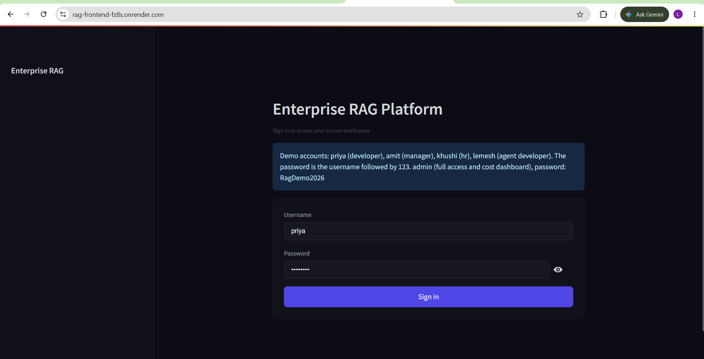
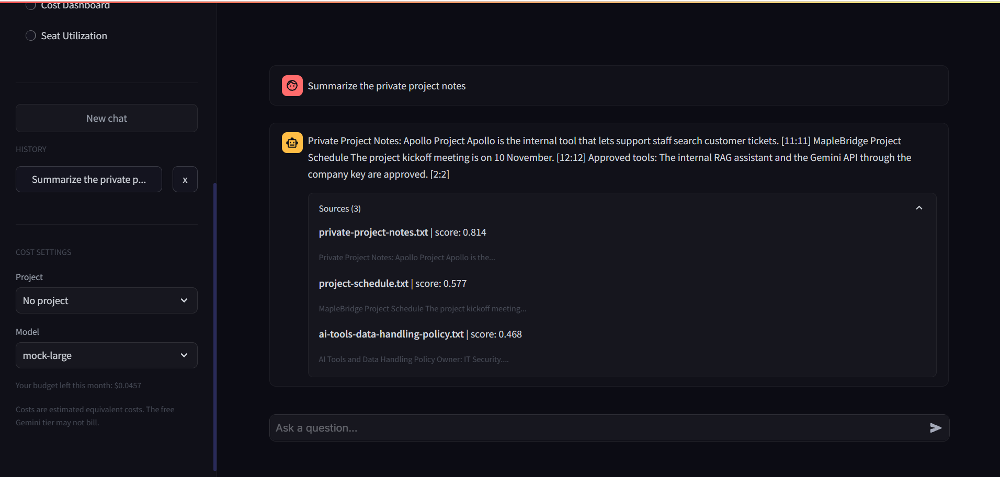
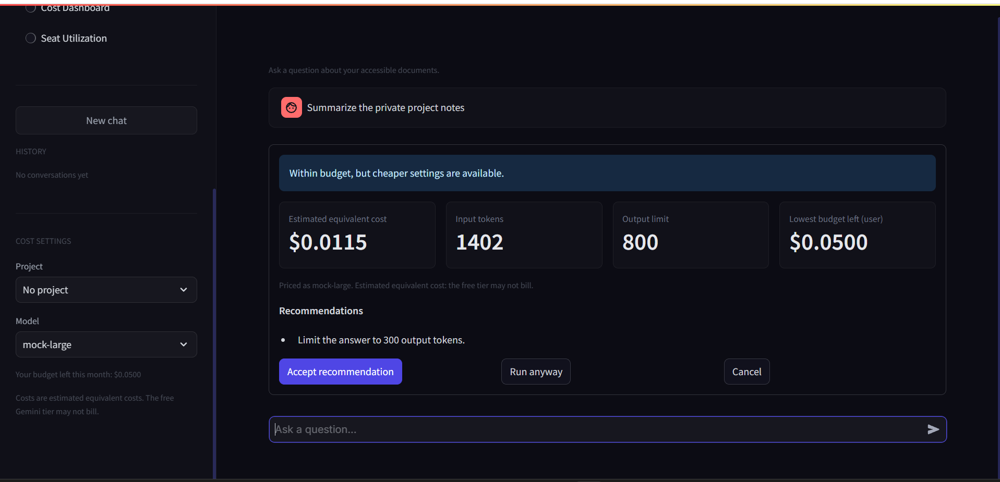
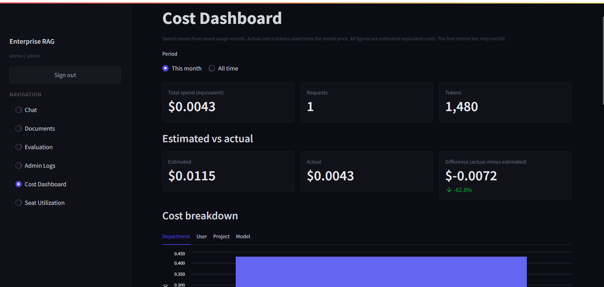
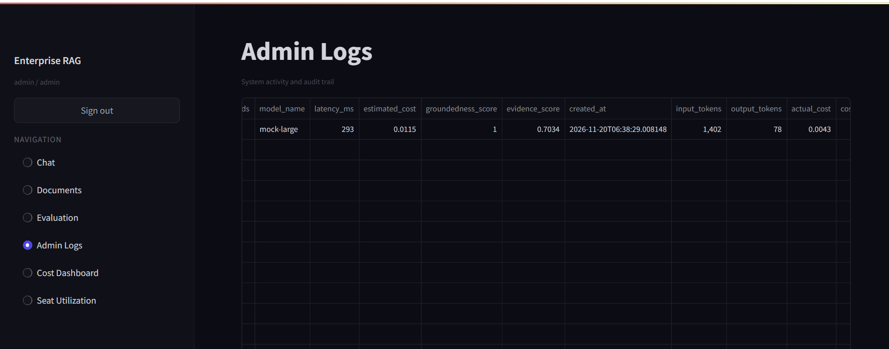
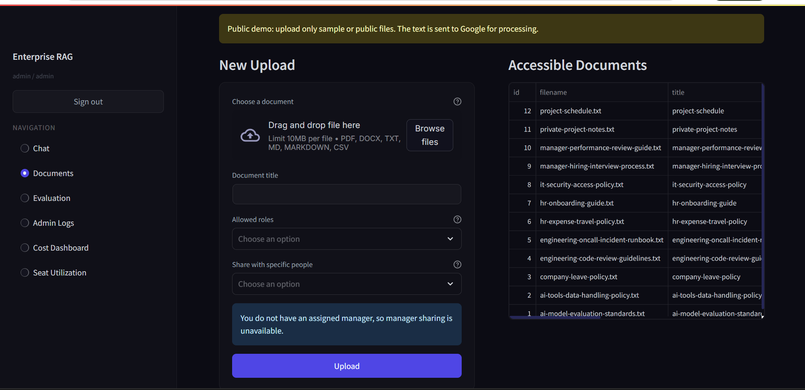
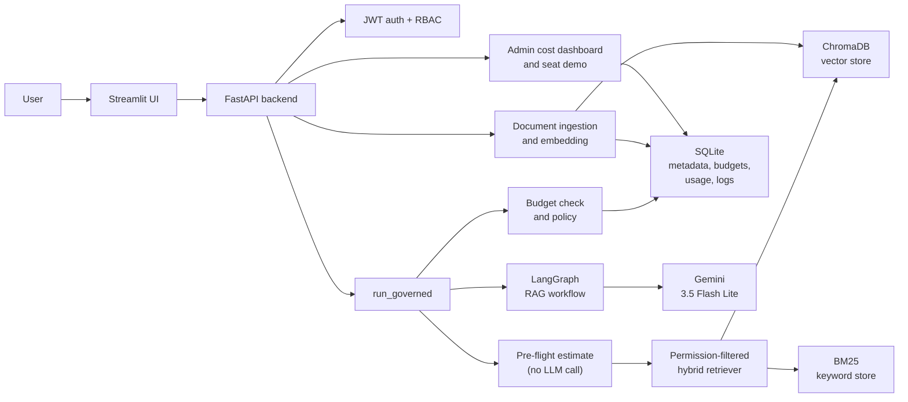

# Enterprise RAG Agent Platform with AI Cost Governance

An internal AI assistant for private company documents with built-in cost governance. Employees ask questions and get answers grounded only in documents they are allowed to access. Every answer carries a source citation. Before every request, the system estimates the cost, checks budgets, and warns or blocks expensive requests. Weak evidence leads to a refusal instead of a confident-looking guess.

The project focuses on the parts that make an enterprise GenAI platform practical: permission-aware retrieval, evidence-based refusal, citations that point back to source chunks, pre-flight cost estimation, budget policy enforcement, estimated-versus-actual cost tracking, and logs that make quality measurable.

> **Live demo:** https://rag-frontend-fz8s.onrender.com
> Hosted on Render free tier. May take up to 60 seconds to wake up on the first visit.
> Refresh once if it times out.


## Screenshots

### Login page


### Chat answer with citations


### Cost governance card


### Admin cost dashboard


### Admin logs


### Documents



## Demo accounts

| Username | Role | Password | Can see |
|---|---|---|---|
| priya | Developer | priya123 | Engineering docs, Apollo project notes |
| amit | Manager | amit123 | Manager guides, HR docs, shared docs |
| khushi | HR | khushi123 | HR documents |
| lemesh | Agent developer | lemesh123 | Engineering documents |
| admin | Admin | RagDemo2026 | All documents, cost dashboard, admin logs |

Uploads are shared across demo accounts. Use only public or sample files. Text is sent to Google for processing on the free tier.


## What this project shows

Most RAG demos skip the parts that make enterprise systems hard. This project focuses on those parts.

| Area | What is built |
|---|---|
| Permission-aware retrieval | The permission filter runs before vector search and keyword search. Private chunks are never retrieved and filtered after the fact. |
| Evidence-based refusal | If the retrieved evidence is too weak, the system refuses instead of guessing. |
| Source citations | Every factual claim carries a `[doc_id:chunk_id]` citation. The Sources box shows the filename, page and excerpt. |
| Cost governance | Before every LLM call, the server estimates the cost, checks user, department and project budgets, and returns allow, warn, recommend or block. The browser never decides. |
| Estimated vs actual | After each request, actual token counts (from Gemini's usage report) are saved and compared with the estimate. |
| Audit logs | Every query is logged with latency, model name, retrieved chunks, citations, evidence score, groundedness score, estimated cost and actual cost. |
| Role-based access | Five roles: admin, agent_developer, developer, manager, hr. Documents are shared by role, by user ID, or by manager relationship. |
| Streaming responses | Answers stream word by word using Server-Sent Events. |


## Architecture



The core rule: **private chunks are never retrieved and then filtered after the fact.** Vector search uses Chroma metadata filters. BM25 builds its corpus only from documents the user can access. The hybrid retriever also runs a final access check before anything reaches the RAG workflow.


---


## Tech stack

| Layer | Technology |
|---|---|
| Frontend | Streamlit, deployed on Render |
| Backend | FastAPI, deployed on Render |
| Database | SQLite with SQLAlchemy (create_all, no migrations) |
| Vector store | ChromaDB with persistent storage |
| Embeddings | Gemini Embedding 001, 768 dimensions |
| LLM | Gemini 3.5 Flash Lite |
| AI workflow | LangGraph |
| Keyword search | BM25 via rank-bm25 |
| Auth | JWT bearer tokens, bcrypt passwords |
| Tests | pytest, 180 tests |
| Containers | Docker Compose |


## Retrieval results

Measured on 20 questions across 12 realistic office documents, using Chroma as the vector store.

| Metric | Hash embeddings | Gemini embeddings |
|---|---|---|
| Correct document in top 5 | 20 of 20 | 20 of 20 |
| Real questions answered | 20 of 20 | 20 of 20 |
| Unanswerable questions refused by threshold | 0 of 5 | 2 of 5 |

The remaining 3 unanswerable questions are caught by Gemini's own "not enough information" reply. Hash embeddings answer all real questions but cannot refuse unrelated ones at the same threshold. Gemini embeddings handle both.


## Features

### RAG and document management

- Demo JWT authentication with admin, manager, employee, and guest users
- Upload PDF, DOCX, TXT, Markdown and CSV files (10 MB limit)
- Documents split into overlapping chunks (3,000 chars, 500 overlap) and embedded with Gemini
- Hybrid retrieval: vector search plus BM25 keyword search, combined score 65/35
- Optional cross-encoder reranking
- Evidence score check before every LLM call. Weak evidence returns a refusal, no LLM call made
- Groundedness check on every answer
- Citation format `[doc_id:chunk_id]` with filename, page, excerpt and relevance score
- Conversation history with strict per-user isolation
- Word-by-word streaming via Server-Sent Events
- Evaluation endpoint for retrieval precision

### Cost governance

- Pre-flight estimate: input tokens (characters / 4) plus output limit, priced from the model's rate table
- Budget check across user, department and project budgets. The lowest remaining amount decides
- Policy decisions: **allow** (runs at once), **warn** (50% or more of budget used, needs approval), **recommend** (within budget but cheaper settings available), **block** (over budget, server never runs it even with approval)
- Five recommendation rules: simple HR question, large context, long output expected, repeated question, budget nearly used
- Actual token counts come from Gemini's usage report (thinking tokens count as output)
- Estimated vs actual difference saved after every request
- Monthly budgets reset automatically. Past-month usage is kept in history
- All cost figures are estimated equivalent costs. The free Gemini tier does not bill

### Admin

- Cost dashboard: total spend, cost by user, department, project and model, daily and monthly trends, budget utilization, estimated vs actual, top expensive users and conversations
- Seat utilization CSV demo: unused seats, inactive seats, premium seats to downgrade, potential monthly saving
- Admin-only query logs with latency, model, tokens, cost, evidence and groundedness scores
- All cost endpoints return 403 for non-admins


## Access control

Each document stores an owner, a list of allowed roles and a list of allowed user IDs.

| Rule | Who gets access |
|---|---|
| Owner | Always |
| Allowed roles | Every user with that role |
| Allowed user IDs | Only those specific users |
| Share with manager | Only the uploader's assigned manager |
| Admin | Always sees everything |

The permission filter runs before retrieval. The vector search uses Chroma metadata filters. The BM25 index is built only from documents the user can access. The retriever also runs a final access check on every hydrated chunk.

### User Hierarchy

```text
                        ┌─────────────┐
                        │    Admin    │
                        └──────┬──────┘
                               │
                ┌──────────────┴──────────────┐
                │                             │
         ┌──────┴──────┐               ┌──────┴──────┐
         │     HR      │               │   Manager   │
         └─────────────┘               └──────┬──────┘
                                              │
                                       ┌──────┴──────┐
                                       │   Lemesh    │
                                       └─────────────┘

         ┌─────────────┐
         │   Priya     │
         │ Developer   │
         └─────────────┘
```

- **Admin** manages the system and can access admin logs.
- **HR** and **Manager** are roles under Admin.
- **Lemesh** reports to **Amit**, the Manager.
- **Priya** is an independent Developer and has no assigned manager.
- Priya can still receive explicit access to a document through user-specific sharing.


## Sample documents

12 documents load automatically on startup. No upload is needed to test the app.

| File | Audience |
|---|---|
| engineering-code-review-guidelines.txt | developers, agent developers |
| engineering-oncall-incident-runbook.txt | developers, agent developers |
| ai-model-evaluation-standards.txt | agent developers, developers |
| ai-tools-data-handling-policy.txt | everyone |
| manager-performance-review-guide.txt | managers, HR |
| manager-hiring-interview-process.txt | managers, HR |
| hr-expense-travel-policy.txt | everyone |
| it-security-access-policy.txt | everyone |
| company-leave-policy.txt | everyone |
| hr-onboarding-guide.txt | everyone |
| private-project-notes.txt | priya, lemesh, amit only |
| project-schedule.txt | everyone |

### Test questions to try

| Sign in as | Question | Expected |
|---|---|---|
| priya | How many approvals does a pull request need? | Answer with citation |
| priya | How long does a performance improvement plan last? | Refusal (no access to manager guide) |
| amit | How long does a performance improvement plan last? | Answer: 60 days |
| khushi | What are the Apollo project milestones? | Refusal (private doc) |
| admin | What are the main risks in Project Apollo? | Answer with citation |
| any | What is the CEO salary? | Refusal (not in any document) |


## Local setup

**Prerequisites:** Python 3.11, Docker Desktop, Git

**Clone and configure:**

```powershell
git clone https://github.com/LemeshKN/secure-office-rag-assistant.git
cd secure-office-rag-assistant
copy .env.example .env
# Open .env and add your GEMINI_API_KEY
```

**Run with Docker (recommended):**

```powershell
docker compose up --build
```

Then open:
- Frontend: http://localhost:8501
- Backend health: http://localhost:8000/health

**Run without Docker:**

Backend (terminal 1):
```powershell
cd backend
python -m venv .venv311
.\.venv311\Scripts\activate
pip install -r requirements.txt
uvicorn app.main:app --reload --port 8000
```

Frontend (terminal 2):
```powershell
cd frontend
python -m venv .venv311
.\.venv311\Scripts\activate
pip install -r requirements.txt
streamlit run streamlit_app.py --server.port 8501
```

**Run tests:**

```powershell
cd backend
pytest -q
```

180 tests cover RBAC, ingestion, retrieval permissions, citations, evidence refusal, cost calculation, budgets, policy, recommendations, governed run, admin APIs and seat utilization.


## Key environment variables

| Variable | Default | Purpose |
|---|---|---|
| `GEMINI_API_KEY` | | Gemini API key (required for answers and embeddings) |
| `GEMINI_MODEL` | gemini-3.5-flash-lite | LLM model |
| `GEMINI_EMBEDDING_MODEL` | gemini-embedding-001 | Embedding model |
| `EMBEDDING_PROVIDER` | auto | Set to `gemini` for semantic embeddings |
| `EVIDENCE_THRESHOLD` | 0.45 | Minimum score to answer (use 0.50 with Gemini embeddings) |
| `SECRET_KEY` | change-me-in-production | JWT signing key |
| `ADMIN_PASSWORD` | admin123 | Admin account password |
| `ENVIRONMENT` | local | Set to `production` to enforce strong secrets |
| `PUBLIC_DEMO` | false | Set to `true` to show demo account hints on login |
| `MAX_OUTPUT_TOKENS` | 800 | Default output limit per request |
| `WARN_THRESHOLD` | 0.50 | Budget share that triggers a warning |

Never commit `.env`. Copy `.env.example` and fill in your values.


## API endpoints

| Method | Path | Purpose |
|---|---|---|
| POST | /auth/login | Get a JWT token |
| GET | /auth/me | Current user |
| POST | /documents/upload | Upload and embed a document |
| GET | /documents | List accessible documents |
| POST | /chat | RAG answer (non-streaming) |
| POST | /conversations | Create a conversation |
| POST | /conversations/{id}/messages/stream | Streaming RAG answer |
| POST | /conversations/{id}/messages | RAG answer saved to conversation |
| DELETE | /conversations/{id} | Delete a conversation |
| POST | /evaluate/query | RAG answer with retrieval precision |
| GET | /logs | Admin-only query logs |
| GET | /health | Health check |
| GET | /cost/me | Current user budgets and projects |
| POST | /cost/estimate | Pre-flight estimate and policy decision |
| GET | /cost/admin/summary | Admin: total spend |
| GET | /cost/admin/by-user | Admin: cost by user |
| GET | /cost/admin/by-department | Admin: cost by department |
| GET | /cost/admin/by-project | Admin: cost by project |
| GET | /cost/admin/by-model | Admin: cost by model |
| GET | /cost/admin/trend/daily | Admin: daily spend trend |
| GET | /cost/admin/trend/monthly | Admin: monthly spend trend |
| GET | /cost/admin/budgets | Admin: budget utilization |
| GET | /cost/admin/estimated-vs-actual | Admin: estimate accuracy |
| GET | /cost/admin/top-users | Admin: top spenders |
| GET | /cost/admin/top-conversations | Admin: most expensive conversations |
| POST | /cost/admin/seats/analyze | Admin: seat utilization from CSV |


## Limits

- **Data resets on restart.** Render's free tier uses ephemeral disk storage. Uploads, chats and cost history may be lost when the service restarts. The 12 sample documents reload automatically.
- **First visit takes up to 60 seconds.** Free services sleep after 15 minutes of inactivity and wake on the next request.
- **Gemini free quota is shared.** If the daily limit is reached, users see a rate limit message.
- **SQLite for simplicity.** A production deployment would use PostgreSQL.
- **Free Gemini tier.** Uploaded text and questions may be used by Google to improve its products. Use only sample or public files.


## Using the app

**Sign in:** Enter your username and password and click **Sign in**.

**Upload a document:**

1. Open **Upload Documents**.
2. Select a file and enter a title.
3. Choose sharing options: allowed roles, specific users, or **Share with my manager**.
4. Click **Upload**.

**Ask a question:**

1. Open **Chat**.
2. Select or create a conversation.
3. Enter your question.
4. Open **Sources** to see the referenced documents and scores.

**Cost card:** If your request triggers a warn or recommend decision, a card appears before the answer. It shows the estimated cost, your remaining budget and recommendations. Click **Accept recommendation**, **Run anyway** or **Cancel**.

**Admin cost dashboard:** Sign in as admin and open **Cost Dashboard** to see total spend, cost by user, department, project and model, estimated vs actual, and top spenders.

**Stop the app:**

```powershell
docker compose down
```


## Evaluation

The **Evaluation** page checks whether the system retrieves the correct document for a question.

**Retrieval precision** = correct retrieved chunks / total retrieved chunks

**Worked example:**

Upload `company-leave-policy.txt`. Note its document ID from the Documents page. Then open Evaluation and fill in:

| Field | Value |
|---|---|
| Question | How many paid leave days do employees receive per year? |
| Expected document IDs | the document ID you noted |
| Expected result | Retrieval precision of 0.8 or higher |


## Troubleshooting

| Problem | Fix |
|---|---|
| Backend does not start | Check the virtual environment and installed requirements |
| Frontend cannot connect | Confirm the backend is running on port 8000 |
| No answer returned | Check that your user has access to the relevant documents |
| Docker fails | Confirm Docker Desktop is running and ports are free |
| First visit is slow | Free hosting sleeps after 15 minutes. Wait 60 seconds and refresh |
| Rate limit message | Wait 1 minute. The free Gemini quota is shared across all demo users |


## Future improvements

- Replace SQLite with PostgreSQL for production reliability
- Add a manager approval workflow for blocked requests
- Add LLM-as-judge evaluation with cost controls
- Add token-by-token streaming per LLM provider instead of word-by-word splitting
- Add CI with GitHub Actions running pytest, linting and Docker build
- Add pgvector or OpenSearch as retrieval backends
- Add SSO and multi-tenant support


## License

MIT License. Copyright (c) 2026 LemeshKN. Free to use, copy and modify with attribution.
