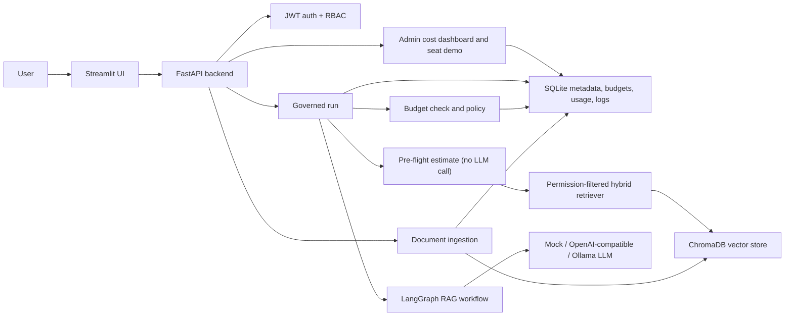

# Enterprise RAG Agent Platform

This is a backend-first Enterprise RAG project with document upload, role-based access control, user-specific sharing, manager sharing, conversation history, citation-grounded answers, evidence checks, query logging, evaluation metrics, word-by-word streaming responses, and a Streamlit UI.

The goal was not to build another chatbot demo. This project focuses on the parts that make an internal GenAI platform practical: private documents, permission-aware retrieval, refusal when evidence is weak, citations that point back to source chunks, saved conversations, and logs that make quality measurable.

## Documentation

For detailed local setup, Docker deployment, environment variables, privacy testing, sample documents, and production recommendations, see [docs/DEPLOYMENT.md](docs/DEPLOYMENT.md).
## Demo Screenshots

.Screenshots to add in `docs/screenshots/`:

- Chat page with the project and model dropdowns
- Recommend card (Accept recommendation, Run anyway, Cancel)
- Warn card
- Block card (Cancel only)
- Answer with `[doc_id:chunk_id]` citations
- Cost Dashboard: totals, breakdown tabs, trends, budget utilization
- Estimated vs actual panel
- Admin Logs with token and cost columns
- Seat Utilization results from the sample CSV
- `docker compose up` running in the terminal

## What This Project Shows

Most RAG demos skip the parts that make enterprise systems hard. This project focuses on those parts:

- Retrieval is filtered by permissions before chunks reach the LLM.
- Streamlit is only a frontend. The backend owns ingestion, retrieval, auth, logging, generation, and evaluation.
- Answers include source citations like `[doc_id:chunk_id]`.
- Weak evidence leads to a refusal instead of a confident-looking guess.
- Queries are logged with latency, model name, retrieved chunks, citations, evidence score, and groundedness score.
- The app can run without paid API keys by using local or fallback embeddings and a mock grounded LLM.

## Architecture



The main rule is simple: **private chunks should never be retrieved and then filtered after the fact**. Vector search uses Chroma metadata filters, and keyword search builds its BM25 corpus only from documents the user is allowed to access. The hybrid retriever also performs a final authorization check before anything is sent into the RAG workflow.

## Core Features

- Demo JWT authentication with admin, manager, employee, and guest users
- Document upload for PDF, DOCX, TXT, Markdown, and CSV
- SQLite metadata storage for users, documents, chunks, and query logs
- ChromaDB persistent vector storage
- Hybrid retrieval with vector search plus BM25 keyword search
- Optional reranking with a cross-encoder when installed
- LangGraph workflow for retrieve, rerank, evidence check, generation, grounding, and final response
- Citation formatting with document ID, chunk ID, filename, page number, excerpt, and relevance score
- Deterministic evidence and grounding checks
- Conversation history with strict per-user isolation
- Role-based document sharing
- User-specific document sharing
- Manager-based document sharing
- Word-by-word streaming chat responses using Server-Sent Events
- Admin-only query log endpoint
- Evaluation endpoint for retrieval precision and quality metrics
- Docker and local development support
- pytest coverage for RBAC, ingestion, retrieval permissions, citations, evidence refusal, and admin logs

## User Hierarchy

```text
                        ┌─────────────┐
                        │    Admin    │
                        └──────┬──────┘
                               │
                ┌──────────────┴──────────────┐
                │                             │
         ┌──────┴──────┐               ┌──────┴──────┐
         │     HR      │               │   Manager   │
         └─────────────┘               └──────┬──────┘
                                              │
                                       ┌──────┴──────┐
                                       │   Lemesh    │
                                       └─────────────┘

         ┌─────────────┐
         │   Priya     │
         │ Developer   │
         └─────────────┘
```

- **Admin** manages the system and can access admin logs.
- **HR** and **Manager** are roles under Admin.
- **Lemesh** reports to **Amit**, the Manager.
- **Priya** is an independent Developer and has no assigned manager.
- Priya can still receive explicit access to a document through user-specific sharing.

## Tech Stack

- Python 3.11
- FastAPI
- Streamlit
- SQLAlchemy
- SQLite
- ChromaDB
- LangGraph
- rank-bm25
- OpenAI-compatible clients
- Optional Anthropic, Gemini, and Ollama support
- pytest
- Docker Compose

## Running With Docker

```bash
cp .env.example .env
docker compose up --build
```

Then open:

- Frontend: http://localhost:8501
- Backend docs: http://localhost:8000/docs
- Health check: http://localhost:8000/health

If Windows blocks port `8501` with `WinError 10013`, run the frontend locally on another port such as `8640`.

## Local Development

Start the backend:

```bash
cd backend
python -m venv .venv
.venv\Scripts\activate
python -m pip install -r requirements.txt
python -m uvicorn app.main:app --reload --port 8000
```

Start the frontend in a second terminal:

```bash
cd frontend
python -m venv .venv
.venv\Scripts\activate
python -m pip install -r requirements.txt
set BACKEND_URL=http://localhost:8000
python -m streamlit run streamlit_app.py --server.port 8640
```

On PowerShell, use this instead of `set`:

```powershell
$env:BACKEND_URL="http://localhost:8000"
python -m streamlit run streamlit_app.py --server.address=127.0.0.1 --server.port=8640
```

The backend requirements skip `sentence-transformers` on Windows by default because PyTorch can fail on long paths. The app still runs through the deterministic embedding fallback. To install the optional semantic embedding stack on Windows, enable Windows Long Paths first, then run:

```bash
cd backend
python -m pip install -r requirements-optional-windows.txt
```

## Demo Users

| Username | Password | Role |
| --- | --- | --- |
| `admin` | `admin123` | `admin` |
| `manager` | `manager123` | `manager` |
| `employee` | `employee123` | `employee` |
| `guest` | `guest123` | `guest` |

These users are created automatically when the backend starts.

## Sample Documents

The `sample_documents/` folder contains small files for demonstrating RAG, sharing, and privacy behavior.

| File | Purpose |
| --- | --- |
| `company-leave-policy.txt` | Test general policy questions |
| `hr-onboarding-guide.txt` | Test HR-role document access |
| `private-project-notes.txt` | Test private document isolation |
| `project-schedule.txt` | Test manager sharing |

Example questions:

```text
How many paid leave days do employees receive per year?
When is the MapleBridge project checkpoint scheduled?
What must new employees complete on their first day?
When is the internal budget review scheduled?
```

## Demo Walkthrough

1. Log in as `manager / manager123`.
2. Upload `project-schedule.txt`.
3. Select **Share with my manager**.
4. Log in as the assigned manager and ask:

   ```text
   When is the MapleBridge project checkpoint scheduled?
   ```

5. Confirm the manager receives a citation-grounded answer.
6. Log in as a user without access and ask the same question.
7. Confirm the system refuses instead of revealing the document content.
8. Test user-specific sharing by sharing a document with another user’s ID.
9. Open **Evaluation** and test retrieval precision using the document ID.
10. Log in as `admin / admin123` and open Admin Logs to review saved queries.

## API Endpoints

| Method | Path | Purpose |
| --- | --- | --- |
| `POST` | `/auth/login` | Create a JWT access token |
| `GET` | `/auth/me` | Return the current user |
| `GET` | `/auth/me/manager` | Return the current user’s assigned manager |
| `GET` | `/auth/users` | List users for user-specific sharing |
| `POST` | `/documents/upload` | Upload and ingest a document |
| `GET` | `/documents` | List accessible documents |
| `POST` | `/chat` | Run the RAG workflow |
| `POST` | `/conversations` | Create a chat conversation |
| `GET` | `/conversations` | List the current user’s conversations |
| `GET` | `/conversations/{id}/messages` | Get messages in a conversation |
| `POST` | `/conversations/{id}/messages` | Ask a question and save the response |
| `POST` | `/conversations/{id}/messages/stream` | Ask a question with word-by-word streaming |
| `DELETE` | `/conversations/{id}` | Delete a conversation |
| `POST` | `/evaluate/query` | Run a query with evaluation metrics |
| `GET` | `/logs` | Admin-only query logs with token and cost fields|
| `GET` | `/health` | Backend health check |
| `GET` | `/cost/me` | Current user's department, budgets and projects |
| `POST` | `/cost/estimate` | Pre-flight estimate, policy decision and recommendations |
| `GET` | `/cost/admin/summary` | Admin: total spend, requests, tokens |
| `GET` | `/cost/admin/by-user`, `/by-department`, `/by-project`, `/by-model` | Admin: cost breakdowns |
| `GET` | `/cost/admin/trend/daily`, `/trend/monthly` | Admin: spend trends |
| `GET` | `/cost/admin/budgets` | Admin: budget utilization |
| `GET` | `/cost/admin/estimated-vs-actual` | Admin: estimate accuracy |
| `GET` | `/cost/admin/top-users`, `/top-conversations` | Admin: top spenders |
| `POST` | `/cost/admin/seats/analyze` | Admin: seat utilization from a CSV |

## How Access Control Works

Each document stores:

- owner user ID
- allowed roles
- allowed user IDs

The rules are:

- Admins can access everything.
- Owners can access their own documents.
- A role can access a document only when that role is listed in `allowed_roles`.
- A user can access a document when their user ID is listed in `allowed_user_ids`.
- A manager can access an employee’s document when the employee selects **Share with my manager**.

### Sharing methods

| Method | Who gets access |
| --- | --- |
| Allowed roles | Everyone with the selected role |
| Allowed user IDs | Only the selected users |
| Share with my manager | Only the uploader’s assigned manager |

This matters most during retrieval. The app does not retrieve a large pool of private chunks and clean it up later. Permission filters are applied before vector candidates are returned and before the keyword index is searched.

## RAG Workflow

The RAG workflow lives in `backend/app/rag/graph.py`.

The flow is:

1. Retrieve accessible chunks.
2. Rerank them.
3. Score the available evidence.
4. Refuse if the evidence is too weak.
5. Generate an answer using only the retrieved context.
6. Check groundedness with a deterministic heuristic.
7. Return the answer, citations, metrics, and retrieved metadata.

The generation prompt tells the model to answer only from provided context and cite every factual claim using `[doc_id:chunk_id]`.

## Cost Governance

Every chat request goes through one function, `run_governed`. The routes `/chat`, the stream route, `send_message` and `/evaluate/query` all use it.

1. The server runs permission-filtered retrieval and builds the final prompt. No LLM call happens.
2. It estimates the cost: input tokens (characters divided by 4, rounded up) plus the output limit (default 800), priced from the model's rate.
3. It checks the user, department and project budgets. The lowest remaining amount decides.
4. The policy returns one decision:
   - **block**: the estimate is above the lowest remaining budget. The server never runs it, even if the browser sends approval.
   - **warn**: the estimate uses 50% or more of the lowest remaining budget. The user must approve.
   - **recommend**: within budget, but a rule found cheaper settings.
   - **allow**: the request runs at once.
5. After the run, the system saves actual tokens, actual cost and the difference from the estimate. It updates the budgets in the same commit.

Budgets are monthly (Asia/Kolkata). A budget from a past month counts as used 0, and all usage history is kept.

Costs are demo values. The LLM is a mock, so cost is real token counts times a price table, not a provider bill. The mock does not enforce the output limit, so actual cost is usually far below the estimate.

Recommendation rules: simple question, large context, long output expected, repeated question (information only), budget nearly used.

Settings in `.env`: `MAX_OUTPUT_TOKENS`, `WARN_THRESHOLD`, `LARGE_CONTEXT_TOKENS`, `RECOMMENDED_TOP_K`, `SHORT_OUTPUT_TOKENS`, `NEAR_BUDGET_RATIO`, `REPEAT_WINDOW_DAYS`.

## Cost figures are estimated equivalent costs

The Gemini free tier does not bill, so the dollar amounts in this app are not charges.
They are the "estimated equivalent cost": the tokens used, priced at Gemini's paid rates.
Budgets, warnings and the admin dashboard all use this number.

- Prices live in one table: `backend/app/cost/pricing.py`.
- `gemini-3.5-flash-lite` is priced at 0.30 USD input and 2.50 USD output per 1M tokens.
- `gemini-3.8-flash` is priced at 0.75 USD input and 3.75 USD output per 1M tokens
  through 2026-12-31. Google raises it to 1.50 and 7.50 on 2027-01-01.
- After a request, token counts come from the numbers Gemini reports. Thinking tokens
  count as output. The estimate before a request uses characters divided by 4.
- Mock models are priced from the same table.
- On the free tier, Google may use requests to improve its products. Use only sample or
  public documents with a free key.

### Example flow

1. Priya (developer, Engineering) uploads her private project notes.
2. She picks `mock-large` and asks: "Summarize the private project notes."
3. A card shows the estimate (about $0.008), her remaining budget and a recommendation to limit output to 300 tokens.
4. She clicks Accept recommendation. The server recalculates the estimate and runs the request once.
5. The answer carries `[doc_id:chunk_id]` citations.
6. Admin opens Cost Dashboard and sees Engineering spend, estimated vs actual and budget utilization updated.

### Admin access

Admin can see every document in RAG answers, including private notes. This is intended. Every other role sees only documents it owns or that are shared with it, and the permission filter runs before retrieval.

### Seat utilization demo

Admin uploads a CSV of AI seats and sets seat prices. The page shows unused seats, inactive seats, premium seats to downgrade and the potential monthly saving. It uses demo data only and saves nothing.

## Streaming Responses

Chat answers are streamed word by word using Server-Sent Events (SSE).

Backend endpoint:

```text
POST /conversations/{conversation_id}/messages/stream
```

The backend sends small text events to the frontend:

```json
{"type": "token", "content": "Employees"}
```

The Streamlit frontend updates the answer area as each event arrives.

This improves perceived response speed, especially on slow internet connections.

## Evaluation And Logging

Every chat call is logged with:

- user ID
- question
- answer
- cited chunk IDs
- retrieved chunk IDs
- model name
- latency
- estimated cost
- evidence score
- groundedness score

The evaluation endpoint also reports retrieval precision when expected document IDs are provided.

Retrieval precision is calculated as:

\[
\text{Retrieval Precision} =
\frac{\text{Correct retrieved chunks}}{\text{Total retrieved chunks}}
\]

For example, if 4 out of 5 retrieved chunks belong to the expected document, retrieval precision is `0.8`.

## Tests

```bash
cd backend
pytest -q
```

The tests cover:

- RBAC permission logic
- chunking
- retrieval permission filtering
- citation formatting
- weak-evidence refusal
- strong single-chunk evidence
- admin-only logs
- cost calculation
- budgets
- policy
- recommendations
- governed run
- admin cost APIs and seat utilization

## Project Structure

```text
backend/
  app/
    auth/
    ingestion/
    retrieval/
    rag/
    api/
    logging_utils/
  tests/
frontend/
sample_documents/
data/
docs/
  DEPLOYMENT.md
  screenshots/
```

## Future Improvements

- Replace demo auth with a real identity provider.
- Add background jobs for large document ingestion.
- Add tenant isolation and audit export.
- Add pgvector or OpenSearch as retrieval backends.
- Add CI for linting, tests, and Docker build validation.
- Add optional LLM-as-judge evaluation with cost controls.
- Upgrade streaming from word-by-word response streaming to native token-by-token streaming for each LLM provider.

## Resume Bullet

Built an enterprise RAG and agentic workflow platform with role-based document access, user-specific and manager-based sharing, hybrid retrieval, reranking, citation-grounded generation, hallucination detection, conversation history, streaming responses, and automated evaluation. Deployed with FastAPI, Streamlit, Docker, ChromaDB, LangGraph, and multi-provider LLM support, with tracking for latency, cost, groundedness, and retrieval quality.