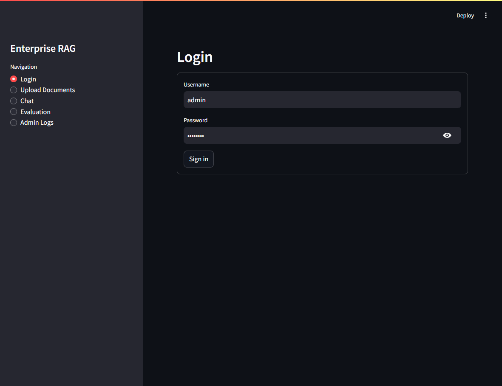
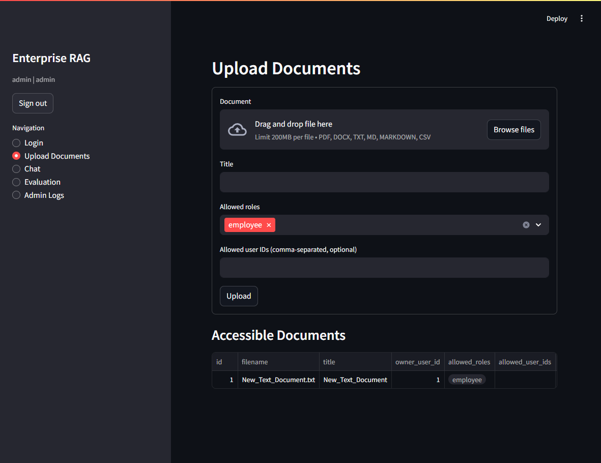
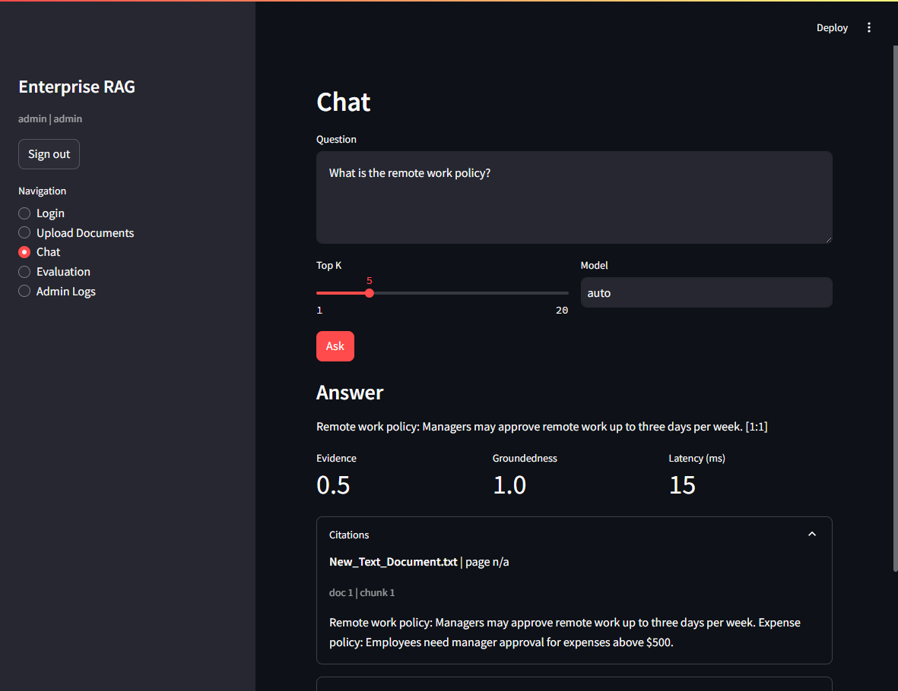
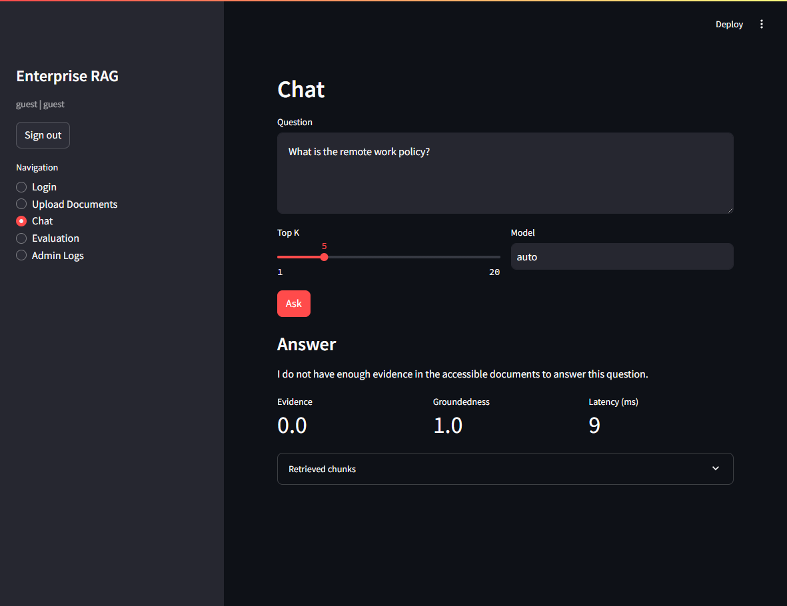
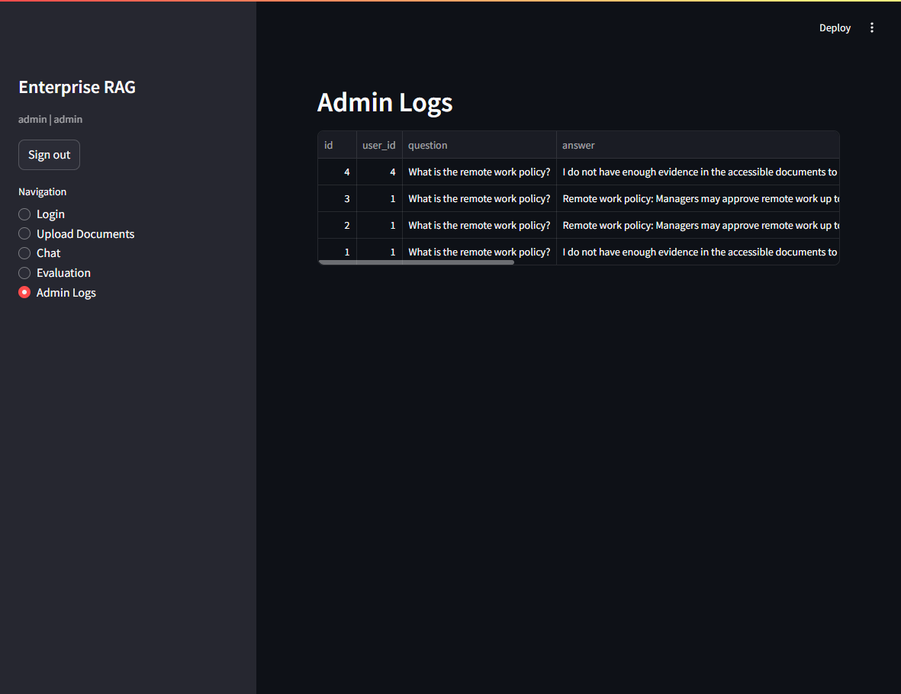
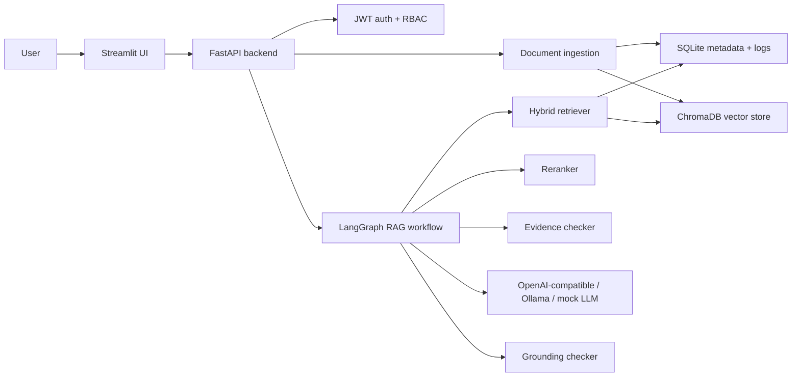

# Enterprise RAG Agent Platform

This is a backend-first Enterprise RAG project with document upload, role-based access control, citation-grounded answers, evidence checks, query logging, evaluation metrics, and a small Streamlit UI on top.

The goal was not to build another chatbot demo. I wanted this to feel closer to the kind of GenAI platform work an internal AI engineering team would actually care about: private documents, permission-aware retrieval, refusal when evidence is weak, citations that point back to source chunks, and logs that make quality measurable.

## Demo

### Login



### Document Upload



### Citation-Grounded Answer



### RBAC Denial

The same question is asked as a guest. Because the uploaded document is not accessible to the guest role, the system refuses instead of leaking the answer.



### Admin Logs



## What This Project Shows

Most RAG demos skip the parts that make enterprise systems hard. This project focuses on those parts:

- Retrieval is filtered by permissions before chunks reach the LLM.
- Streamlit is only a frontend. The backend owns ingestion, retrieval, auth, logging, generation, and evaluation.
- Answers include source citations like `[doc_id:chunk_id]`.
- Weak evidence leads to a refusal instead of a confident-looking guess.
- Queries are logged with latency, model name, retrieved chunks, citations, evidence score, and groundedness score.
- The app can run without paid API keys by using local or fallback embeddings and a mock grounded LLM.

## Architecture



The main rule is simple: **private chunks should never be retrieved and then filtered after the fact**. Vector search uses Chroma metadata filters, and keyword search builds its BM25 corpus only from documents the user is allowed to access. The hybrid retriever also performs a final authorization check before anything is sent into the RAG workflow.

## Core Features

- Demo JWT authentication with admin, manager, employee, and guest users
- Document upload for PDF, DOCX, TXT, Markdown, and CSV
- SQLite metadata storage for users, documents, chunks, and query logs
- ChromaDB persistent vector storage
- Hybrid retrieval with vector search plus BM25 keyword search
- Optional reranking with a cross-encoder when installed
- LangGraph workflow for retrieve, rerank, evidence check, generation, grounding, and final response
- Citation formatting with document ID, chunk ID, filename, page number, and excerpt
- Deterministic evidence and grounding checks
- Admin-only query log endpoint
- Evaluation endpoint for retrieval precision and quality metrics
- Docker and local development support
- pytest coverage for RBAC, ingestion, retrieval permissions, citations, evidence refusal, and admin logs

## Tech Stack

- Python 3.11
- FastAPI
- Streamlit
- SQLAlchemy
- SQLite
- ChromaDB
- LangGraph
- rank-bm25
- OpenAI-compatible clients
- Optional Anthropic, Gemini, and Ollama support
- pytest
- Docker Compose

## Running With Docker

```bash
cp .env.example .env
docker compose up --build
```

Then open:

- Frontend: http://localhost:8501
- Backend docs: http://localhost:8000/docs
- Health check: http://localhost:8000/health

If Windows blocks port `8501` with `WinError 10013`, run the frontend locally on another port such as `8640`.

## Local Development

Start the backend:

```bash
cd backend
python -m venv .venv
.venv\Scripts\activate
python -m pip install -r requirements.txt
python -m uvicorn app.main:app --reload --port 8000
```

Start the frontend in a second terminal:

```bash
cd frontend
python -m venv .venv
.venv\Scripts\activate
python -m pip install -r requirements.txt
set BACKEND_URL=http://localhost:8000
python -m streamlit run streamlit_app.py --server.port 8640
```

On PowerShell, use this instead of `set`:

```powershell
$env:BACKEND_URL="http://localhost:8000"
python -m streamlit run streamlit_app.py --server.address=127.0.0.1 --server.port=8640
```

The backend requirements skip `sentence-transformers` on Windows by default because PyTorch can fail on long paths. The app still runs through the deterministic embedding fallback. To install the optional semantic embedding stack on Windows, enable Windows Long Paths first, then run:

```bash
cd backend
python -m pip install -r requirements-optional-windows.txt
```

## Demo Users

| Username | Password | Role |
| --- | --- | --- |
| `admin` | `admin123` | `admin` |
| `manager` | `manager123` | `manager` |
| `employee` | `employee123` | `employee` |
| `guest` | `guest123` | `guest` |

These users are created automatically when the backend starts.

## Demo Walkthrough

1. Log in as `admin / admin123`.
2. Upload a policy document and restrict it to a specific role.
3. Ask a question in Chat and confirm the answer includes a citation.
4. Sign out and log in as `guest / guest123`.
5. Ask the same question.
6. Confirm the guest cannot retrieve or see the restricted document.
7. Log back in as admin and open Admin Logs to review the saved queries.

## API Endpoints

| Method | Path | Purpose |
| --- | --- | --- |
| `POST` | `/auth/login` | Create a JWT access token |
| `GET` | `/auth/me` | Return the current user |
| `POST` | `/documents/upload` | Upload and ingest a document |
| `GET` | `/documents` | List accessible documents |
| `POST` | `/chat` | Run the RAG workflow |
| `POST` | `/evaluate/query` | Run a query with evaluation metrics |
| `GET` | `/logs` | Admin-only query logs |
| `GET` | `/health` | Backend health check |

## How Access Control Works

Each document stores:

- owner user ID
- allowed roles
- allowed user IDs

The rules are:

- Admins can access everything.
- Owners can access their own documents.
- A role can access a document only when that role is listed in `allowed_roles`.
- A user can access a document when their user ID is listed in `allowed_user_ids`.

This matters most during retrieval. The app does not retrieve a large pool of private chunks and clean it up later. Permission filters are applied before vector candidates are returned and before the keyword index is searched.

## RAG Workflow

The RAG workflow lives in `backend/app/rag/graph.py`.

The flow is:

1. Retrieve accessible chunks.
2. Rerank them.
3. Score the available evidence.
4. Refuse if the evidence is too weak.
5. Generate an answer using only the retrieved context.
6. Check groundedness with a deterministic heuristic.
7. Return the answer, citations, metrics, and retrieved metadata.

The generation prompt tells the model to answer only from provided context and cite every factual claim using `[doc_id:chunk_id]`.

## Evaluation And Logging

Every chat call is logged with:

- user ID
- question
- answer
- cited chunk IDs
- retrieved chunk IDs
- model name
- latency
- estimated cost
- evidence score
- groundedness score

The evaluation endpoint also reports retrieval precision when expected document IDs are provided.

## Tests

```bash
cd backend
pytest -q
```

The tests cover:

- RBAC permission logic
- chunking
- retrieval permission filtering
- citation formatting
- weak-evidence refusal
- strong single-chunk evidence
- admin-only logs

## Project Structure

```text
backend/
  app/
    auth/
    ingestion/
    retrieval/
    rag/
    api/
    logging_utils/
  tests/
frontend/
data/
docs/screenshots/
```

## Future Improvements

- Replace demo auth with a real identity provider.
- Add background jobs for large document ingestion.
- Add tenant isolation and audit export.
- Add pgvector or OpenSearch as retrieval backends.
- Add CI for linting, tests, and Docker build validation.
- Add optional LLM-as-judge evaluation with cost controls.

## Resume Bullet

Built an enterprise RAG and agentic workflow platform with role-based document access, hybrid retrieval, reranking, citation-grounded generation, hallucination detection, and automated evaluation. Deployed with FastAPI, Streamlit, Docker, ChromaDB, LangGraph, and multi-provider LLM support, with tracking for latency, cost, groundedness, and retrieval quality.

